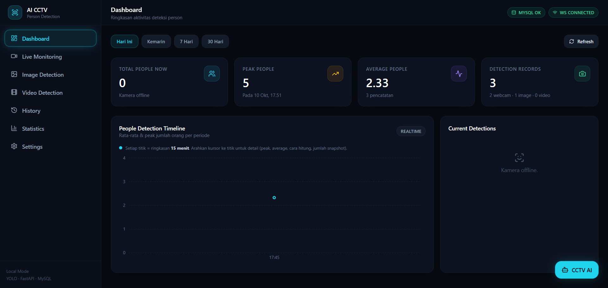
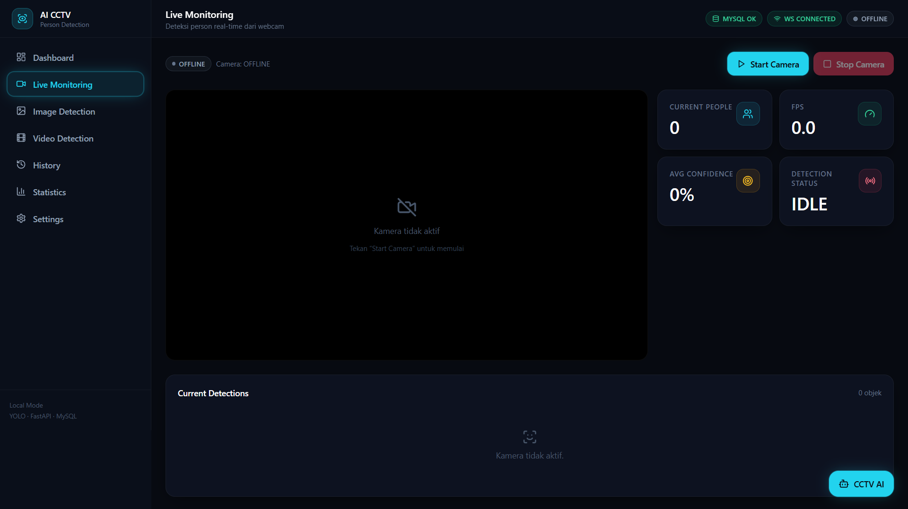
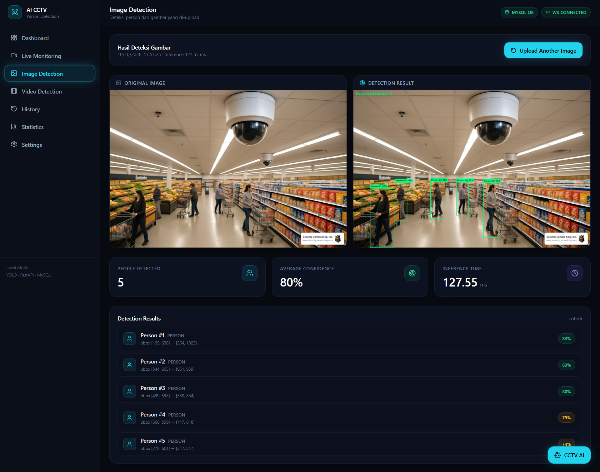
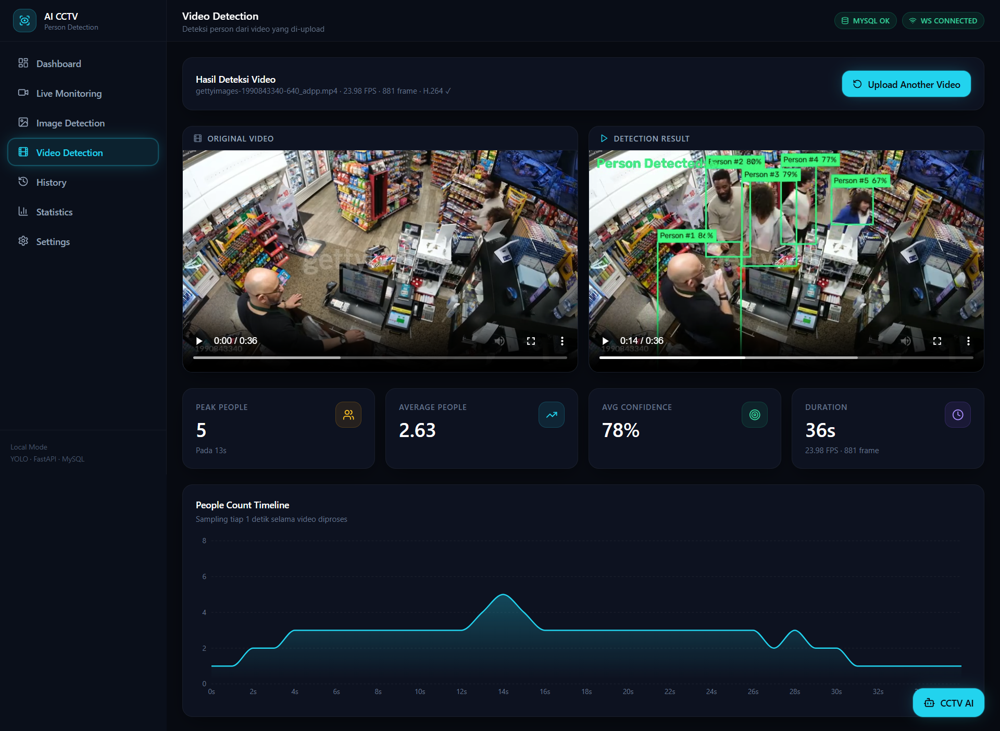
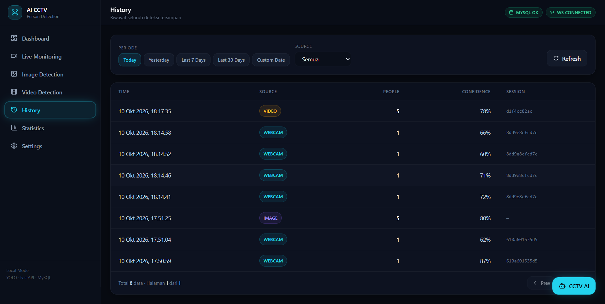
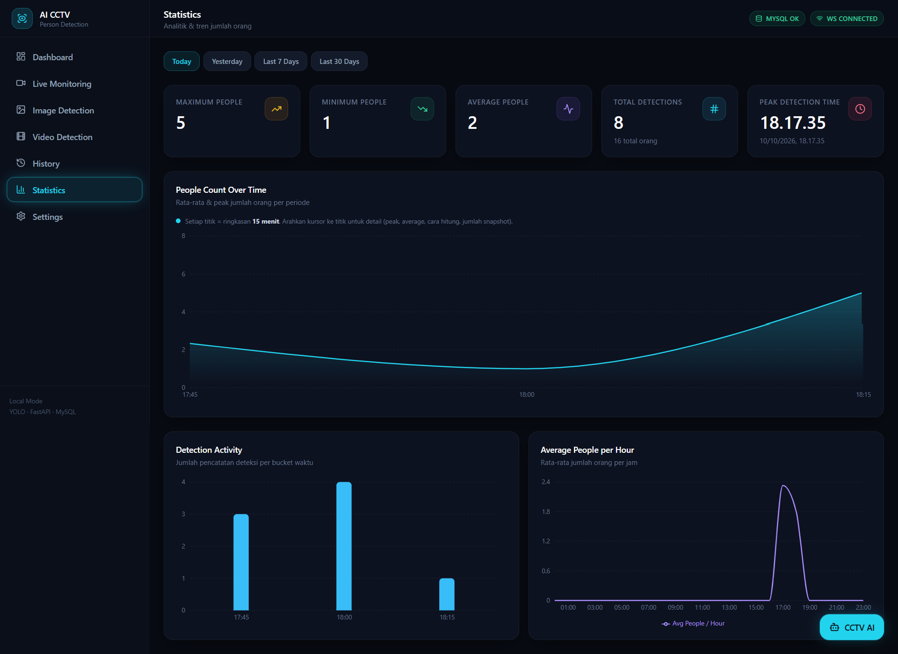
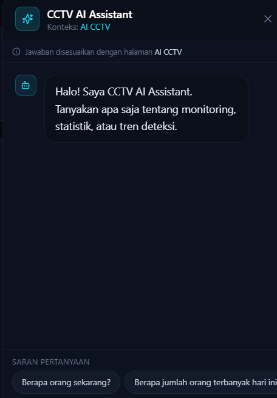
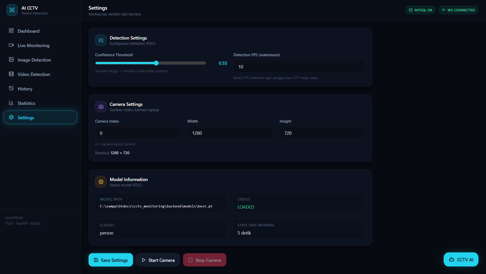

# 🎥 AI CCTV Person Detection & Monitoring System

Sistem monitoring person lokal berbasis AI yang mendeteksi dan menghitung orang secara real-time dari **webcam laptop**, **upload gambar**, dan **upload video**. Menggunakan model **YOLO26n custom trained** (1 kelas: `person`) dengan backend FastAPI, frontend React, dan database MySQL.


---

## ✨ Fitur Utama

| Fitur | Deskripsi |
|-------|-----------|
| 🎥 **Live Monitoring** | Deteksi person real-time dari webcam laptop via WebSocket dengan bounding box & FPS |
| 🖼️ **Image Detection** | Deteksi dari gambar yang di-upload dengan preview side-by-side (original vs hasil) |
| 🎬 **Video Detection** | Deteksi per-frame dengan progress bar live, transcode H.264 otomatis, dan player side-by-side |
| 📊 **Dashboard** | Ringkasan statistik hari ini (peak, average, total record) + timeline chart |
| 📈 **Statistics** | Analitik lengkap dengan 3 chart Recharts: timeline, activity, hourly average |
| 📜 **History** | Riwayat deteksi dengan filter periode & sumber, dilengkapi pagination |
| 🤖 **Chatbot Context-Aware** | Menjawab pertanyaan berdasarkan data aktual MySQL, disesuaikan dengan halaman aktif |
| ⚙️ **Settings Persist** | Konfigurasi confidence, FPS, dan kamera — tersimpan permanen ke disk |

---

## 🏗️ Arsitektur Sistem
┌─────────────────┐ ┌──────────────────┐ ┌─────────────┐
│ │ │ │ │ │
│ React Frontend │◄──WS───►│ FastAPI Backend │◄───────►│ MySQL │
│ (Vite) │◄──HTTP──┤ │ │ (XAMPP) │
│ │ │ │ │ │
└─────────────────┘ └────────┬─────────┘ └─────────────┘
│
▼
┌──────────────────┐
│ YOLO26n Model │
│ (best.pt) │
└──────────────────┘
▲
│
┌──────────┴──────────┐
│ │
Webcam / Image Video

text

---

## 🛠️ Tech Stack

### Frontend


- **React.js 18** — Library UI
- **Vite 6** — Build tool & dev server
- **Tailwind CSS 3** — Styling utility-first
- **Zustand** — State management + persist middleware
- **Recharts** — Chart interaktif
- **Axios** — HTTP client
- **React Router** — Client-side routing
- **Lucide React** — Icon set

### Backend


- **FastAPI** — Web framework
- **Uvicorn** — ASGI server
- **Ultralytics YOLO** — Object detection framework
- **OpenCV** — Image/video processing
- **SQLAlchemy** — ORM
- **PyMySQL** — MySQL driver
- **imageio-ffmpeg** — Video transcode H.264
- **WebSocket** — Real-time communication

### AI / Model
- **YOLO26n** — Custom trained model
- **Dataset**: 7.096 gambar CCTV (5.976 train / 1.120 validasi)
- **Training**: 50 epoch di Google Colab (Tesla T4 GPU)
- **Performance**:
  - **mAP50**: 94.5%
  - **Precision**: 93.9%
  - **Recall**: 87.1%
  - **mAP50-95**: 64.7%
  - **Inference**: 3.8 ms/image (GPU)
- **Kelas**: 1 (`person`)

### Database
- **MySQL** via XAMPP (port 3306, user `root`, tanpa password default)

---

## 📁 Struktur Project
cctv_monitoring/
│
├── backend/
│ ├── app/
│ │ ├── api/ # Endpoint FastAPI
│ │ │ ├── detection.py # POST /api/detection/image, /video
│ │ │ ├── camera.py # Webcam control + settings
│ │ │ ├── statistics.py # Statistik & history
│ │ │ └── chatbot.py # POST /api/chat
│ │ │
│ │ ├── services/ # Business logic
│ │ │ ├── detector.py # YOLO singleton
│ │ │ ├── webcam_service.py # Worker thread webcam
│ │ │ ├── image_service.py # Image processing
│ │ │ ├── video_service.py # Video processing + transcode
│ │ │ ├── statistics_service.py
│ │ │ ├── chatbot_service.py # Intent detection + query
│ │ │ └── cleanup_service.py # Auto-cleanup file
│ │ │
│ │ ├── database/
│ │ │ ├── database.py # SQLAlchemy engine & session
│ │ │ └── models.py # DetectionHistory
│ │ │
│ │ ├── schemas/ # Pydantic schemas
│ │ ├── config.py # Settings & runtime settings
│ │ └── main.py # FastAPI entry point
│ │
│ ├── models/
│ │ └── best.pt # Model YOLO (tidak di-commit)
│ │
│ ├── uploads/ # File upload user (auto-cleanup)
│ ├── processed/ # Hasil deteksi (auto-cleanup)
│ ├── requirements.txt
│ ├── .env # (tidak di-commit)
│ ├── .env.example
│ └── run.py
│
└── frontend/
├── src/
│ ├── components/ # Reusable components
│ │ ├── Sidebar.jsx
│ │ ├── Header.jsx
│ │ ├── StatCard.jsx
│ │ ├── CameraFeed.jsx
│ │ ├── ImageUploader.jsx
│ │ ├── VideoUploader.jsx
│ │ ├── DetectionList.jsx
│ │ ├── Chatbot.jsx
│ │ └── Charts.jsx
│ │
│ ├── pages/ # Halaman utama
│ │ ├── Dashboard.jsx
│ │ ├── LiveMonitoring.jsx
│ │ ├── ImageDetection.jsx
│ │ ├── VideoDetection.jsx
│ │ ├── History.jsx
│ │ ├── Statistics.jsx
│ │ └── Settings.jsx
│ │
│ ├── services/
│ │ ├── api.js # Axios wrapper
│ │ └── websocket.js # WebSocket client
│ │
│ ├── store/
│ │ └── detectionStore.js # Zustand + persist
│ │
│ ├── App.jsx
│ ├── main.jsx
│ └── index.css
│
├── package.json
├── vite.config.js
├── tailwind.config.js
└── postcss.config.js

text

---

## 🚀 Cara Menjalankan

### Prasyarat

- **Python** 3.11 atau lebih baru
- **Node.js** 18 atau lebih baru
- **XAMPP** (MySQL)
- **Model YOLO** `best.pt` — letakkan di `backend/models/`
- **Git** (untuk clone)

### 1️⃣ Clone Repository

```bash
git clone https://github.com/micoandar/ai-cctv-person-detection.git
cd ai-cctv-person-detection
2️⃣ Setup Database
Buka XAMPP Control Panel

Klik Start pada MySQL (Apache opsional)

Buka http://localhost/phpmyadmin

Buat database baru: cctv_monitoring

Tabel akan dibuat otomatis saat backend pertama kali dijalankan

3️⃣ Setup Backend
bash
cd backend

# Buat virtual environment
python -m venv venv

# Aktifkan (Windows)
venv\Scripts\activate
# Aktifkan (Linux/Mac)
# source venv/bin/activate

# Install dependencies
pip install -r requirements.txt

# Copy .env.example → .env, sesuaikan jika perlu
copy .env.example .env

# Jalankan
python run.py
Backend berjalan di:

API: http://localhost:8000

Swagger Docs: http://localhost:8000/docs

Health Check: http://localhost:8000/api/health

4️⃣ Setup Frontend
Buka terminal baru:

bash
cd frontend
npm install
npm run dev
Frontend berjalan di: http://localhost:5173

📥 Download Model YOLO
File best.pt tidak disertakan di repository ini karena berukuran besar. Download di:

📦 Releases — pilih versi terbaru

Letakkan di: backend/models/best.pt

⚠️ Penting: Tanpa file best.pt, backend tidak akan bisa melakukan inference.

🔌 API Endpoints
Method	Endpoint	Deskripsi
GET	/api/health	Cek status sistem (DB, model, kamera)
POST	/api/detection/image	Upload gambar untuk deteksi
POST	/api/detection/video	Upload video untuk deteksi (async)
GET	/api/detection/video/{task_id}	Cek status task video
POST	/api/webcam/start	Mulai kamera
POST	/api/webcam/stop	Hentikan kamera
GET	/api/webcam/status	Status kamera
GET	/api/statistics/current	Statistik real-time
GET	/api/statistics/summary	Ringkasan (peak, avg, total)
GET	/api/statistics/history	Riwayat dengan filter & pagination
GET	/api/statistics/timeline	Data timeline untuk chart
GET	/api/statistics/hourly	Rata-rata per jam
POST	/api/chat	Tanya chatbot
GET	/api/settings	Ambil konfigurasi saat ini
PUT	/api/settings	Simpan konfigurasi
POST	/api/settings/reset	Reset ke default
WS	/ws/detection	WebSocket untuk live detection
🎯 Fitur Teknis Unggulan
🧠 Model Loading Efisien
YOLO di-load sekali (lazy singleton + thread lock)

Tidak pernah di-load per-request atau per-frame

⚡ Non-Blocking Inference
Worker webcam berjalan di thread terpisah → event loop FastAPI tetap responsif

Video processing di background thread dengan progress broadcast via WebSocket

📊 Adaptive Statistics
Ada orang → simpan statistik tiap 5 detik

Tidak ada orang → simpan tiap 60 detik (heartbeat)

Mengurangi data redundan sampai ~70%

🎬 Video Codec Handling
OpenCV default output mp4v (tidak kompatibel browser)

Auto-transcode ke H.264 + yuv420p via imageio-ffmpeg

Cache-buster ?t=<timestamp> untuk bypass browser cache

🤖 Chatbot Tanpa Halusinasi
Semua angka berasal dari query MySQL / state deteksi aktual

LLM (opsional) hanya menulis ulang jawaban, tidak menghitung

Context-aware: jawaban disesuaikan dengan halaman aktif

/live → data webcam real-time

/video-detection → data video terakhir

/image-detection → data gambar terakhir

/dashboard, /history, /statistics → semua sumber

🔄 Persistent Settings
Runtime settings disimpan ke runtime_settings.json

Bertahan setelah backend restart

reload_excludes mencegah restart saat file ini ditulis

🧹 Auto-Cleanup
Hapus original image setelah diproses (opsional)

Auto-hapus file lebih tua dari RETENTION_DAYS (default 30 hari)

Worker berjalan tiap 6 jam

⚙️ Konfigurasi .env
env
# App
APP_NAME=AI CCTV Person Detection & Monitoring System
HOST=0.0.0.0
PORT=8000

# Database (default XAMPP)
DATABASE_URL=mysql+pymysql://root:@localhost:3306/cctv_monitoring

# Model
MODEL_PATH=models/best.pt
CONFIDENCE_THRESHOLD=0.50
IOU_THRESHOLD=0.45
IMAGE_SIZE=640
PERSON_CLASS_NAME=person

# Camera
CAMERA_INDEX=0
CAMERA_WIDTH=1280
CAMERA_HEIGHT=720
TARGET_FPS=10
JPEG_QUALITY=70
STREAM_MAX_WIDTH=960

# Statistics
STATS_SAVE_INTERVAL=5

# CORS
CORS_ORIGINS=http://localhost:5173,http://127.0.0.1:5173

# LLM (opsional)
LLM_ENABLED=false
LLM_API_KEY=
LLM_BASE_URL=https://api.openai.com/v1
LLM_MODEL=gpt-4o-mini

# Cleanup
DELETE_ORIGINAL_IMAGE=true
DELETE_ORIGINAL_VIDEO=false
RETENTION_DAYS=30

## 📸 Screenshot

| Dashboard | Live Monitoring |
|:---------:|:---------------:|
|  |  |
| *Ringkasan statistik, timeline chart, dan current detections* | *Deteksi person real-time dari webcam dengan bounding box* |

| Image Detection | Video Detection |
|:---------------:|:---------------:|
|  |  |
| *Deteksi person dari gambar yang di-upload* | *Deteksi per-frame dari video dengan player side-by-side* |

| History | Statistics |
|:-------:|:----------:|
|  |  |
| *Riwayat deteksi dengan filter periode & pagination* | *Analitik tren jumlah orang per periode* |

| Chatbot | Settings |
|:-------:|:--------:|
|  |  |
| *Asisten cerdas berbasis query data aktual MySQL* | *Konfigurasi deteksi, kamera, dan model* |

🐛 Troubleshooting
❌ ModuleNotFoundError: No module named 'cv2'
Pastikan virtual environment aktif dan jalankan:

bash
pip install -r requirements.txt
❌ MySQL tidak dapat terhubung
Buka XAMPP Control Panel → Start MySQL

Cek database cctv_monitoring ada di phpMyAdmin

Kalau port 3306 dipakai, ubah di .env

❌ Model YOLO tidak ditemukan
Letakkan file best.pt di backend/models/best.pt. Download dari Releases.

❌ Webcam tidak terdeteksi
Pastikan tidak ada aplikasi lain yang pakai kamera

Cek izin kamera di OS

Coba CAMERA_INDEX=1 atau lebih di .env

❌ Video tidak bisa diputar di browser
Pastikan imageio-ffmpeg terinstall

Cek codec: file hasil harus H.264, bukan mp4v

Refresh browser dengan Ctrl+F5

❌ Settings reset ke default
Pastikan watchfiles terinstall: pip install watchfiles

File runtime_settings.json harus ada setelah Save

🗺️ Roadmap
☑ Webcam real-time detection
☑ Image upload detection
☑ Video upload detection
☑ Statistics dashboard
☑ Chatbot context-aware
□ Multi-camera support
□ RTSP stream integration
□ Person tracking (unique ID)
□ Export laporan ke PDF/Excel
□ Notifikasi Telegram/WhatsApp
□ Docker deployment
📄 Lisensi
Project ini dilisensikan di bawah MIT License — lihat file LICENSE untuk detail.

👤 Author
Nama Micoandar Justinus Marbun

GitHub: @micoandar

Email: micoandar@gmail.com

🙏 Acknowledgments
Ultralytics — YOLO framework

FastAPI — Backend framework

OpenCV — Computer vision library

Recharts — Chart library

Tailwind CSS — CSS framework

⭐ Kalau project ini bermanfaat, jangan lupa kasih bintang!
